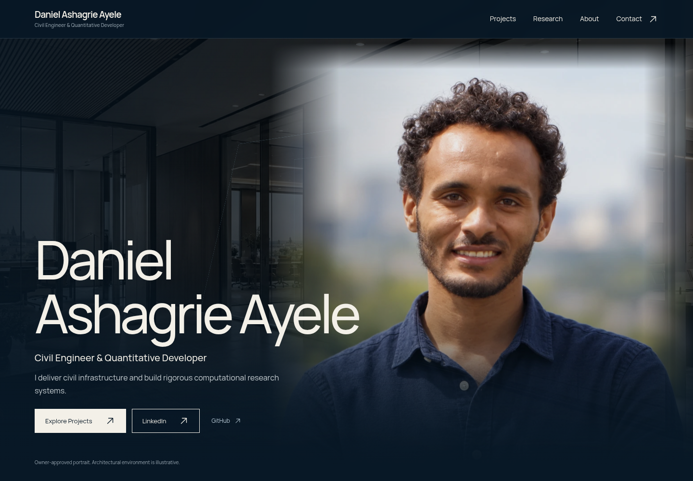
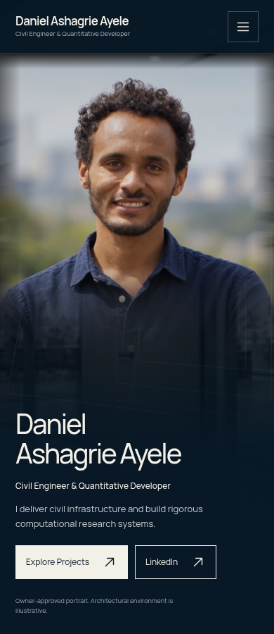

# Daniel Ashagrie Ayele — v7.1 owner review

Civil Engineer & Quantitative Developer

**PUBLICATION: HOLD_PENDING_OWNER_VISUAL_APPROVAL**

Temporary branch: `review/v7-1-owner-approval`. Owner-review artifacts only. No merge, release, GitHub Pages change, deployment, or website publication is authorized.

## Review the portrait

### Desktop ·1440px

### Mobile ·390px

[Old vs new hero comparison](owner-review/HERO_BEFORE_AFTER_COMPARISON.png)

## Download the complete visual review

[Download the validated Review Package ZIP](https://github.com/Danny-Jesus/Danny-Jesus.github.io/raw/refs/heads/review/v7-1-owner-approval/Daniel_Ashagrie_Ayele_Portfolio_FINAL_Cinematic_v7_1_REBUILT_Review_Package.zip)

Extract the ZIP, then open `FINAL_VISUAL_REVIEW_v7_1_REBUILT.html` from the extracted folder. Keep its images, recordings, reports, and other relative files together. GitHub displays the HTML source in its file viewer; downloading and extracting the package provides the full review interface.

Review Package exact size: **91,401,265 bytes**.

SHA-256: `15e7933865584e78ccc02787237221f1adee16c42d9eea8147a1ef0a578b2656`

The original Source and Production ZIPs remain preserved in the cloud workspace. They are not uploaded to this artifact-only review branch.

## Recordings and reports

- [Desktop cinematic recording](owner-review/FINAL_CINEMATIC_SCROLL_REVIEW.mp4)
- [Mobile cinematic recording](owner-review/FINAL_MOBILE_SCROLL_REVIEW.mp4)
- [Final rebuild report](owner-review/FINAL_REBUILD_REPORT.md)
- [Input admission and recovery history](owner-review/INPUT_ADMISSION_REPORT.md)
- [Route validation](owner-review/ROUTE_VALIDATION_REPORT.md)
- [Accessibility](owner-review/ACCESSIBILITY_REPORT.md)
- [Performance](owner-review/PERFORMANCE_REPORT.md)
- [Cinematic QA](owner-review/CINEMATIC_QA_REPORT.md)
- [SEO](owner-review/SEO_REPORT.md)
- [Security](owner-review/SECURITY_REVIEW.md)
- [Asset integrity](owner-review/ASSET_INTEGRITY_REPORT.md)
- [Production member hashes](owner-review/PRODUCTION_SHA256_MANIFEST.txt)

Fresh evidence records 25 public routes plus 404, 50 route/viewport checks, 50 axe scans with zero reported violations, 20 WebGL scene checks, and Lighthouse performance 84 mobile / 89 desktop. Scope limits remain in the reports, including cloud software rendering, blocked LinkedIn origin verification, and blocked direct file opening in the cloud browser.

The ZIP's interior `REBUILD_SHA256_MANIFEST.txt` covers Source/Production ZIP identities without a circular Review ZIP self-hash. The Review ZIP hash is recorded above. The temporary old portrait appears only in labeled comparison evidence.

Daniel must review the desktop/mobile heroes, before/after comparison, both cinematic recordings, offline visual review, QA findings and package integrity before any separate publication authorization.
