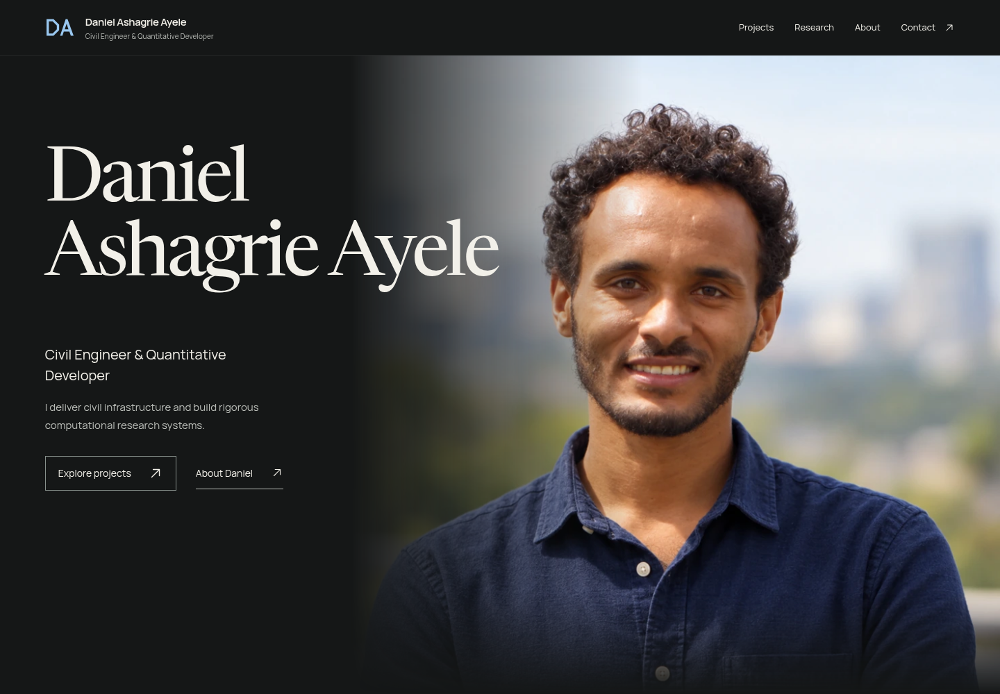
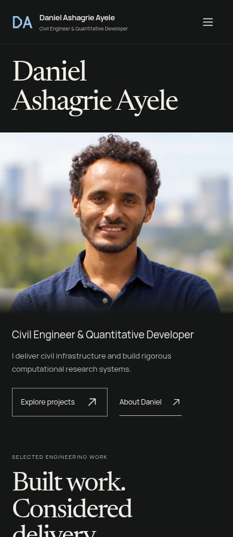

# DANIEL PORTFOLIO v7.4 — FINAL ART DIRECTION OWNER REVIEW ONLY

**TECHNICAL CANDIDATE:** PASS  
**ART DIRECTION:** v7.4 final refinement  
**OWNER VISUAL APPROVAL:** PENDING  
**PUBLICATION:** HOLD_PENDING_OWNER_VISUAL_APPROVAL

**THIS BRANCH MUST NOT BE MERGED INTO MAIN.**

## Download the complete review

**[Download the sealed v7.4 Review Package ZIP](https://github.com/Danny-Jesus/Danny-Jesus.github.io/raw/refs/heads/review/v7-4-owner-approval/Daniel_Ashagrie_Ayele_Portfolio_v7_4_FINAL_ART_DIRECTION_Review_Package.zip)** — 253,552,952 bytes (241.8 MiB). The original archive is stored with Git LFS without changing its bytes.

SHA-256: `3d27ab6ebf48da6fefd4420793c2424672537d8669b1b5dc0c3c690c5c2ab554`.

Extract that ZIP, keep its folders together and open `FINAL_VISUAL_REVIEW_v7_4_FINAL_ART_DIRECTION.html`. Its README includes localhost viewing instructions. GitHub displays the HTML source; the extracted package supplies the local visual-review interface. No site deployment is authorized.

## Start with the hero

## Owner visual review priorities

| Order | Evidence | Direct file |
|---:|---|---|
| 1 | [HERO DESKTOP](owner-review/screenshots/HERO_DESKTOP_V74.png) | [View / download](https://raw.githubusercontent.com/Danny-Jesus/Danny-Jesus.github.io/review/v7-4-owner-approval/owner-review/screenshots/HERO_DESKTOP_V74.png) |
| 2 | [HERO MOBILE](owner-review/screenshots/HERO_MOBILE_V74.png) | [View / download](https://raw.githubusercontent.com/Danny-Jesus/Danny-Jesus.github.io/review/v7-4-owner-approval/owner-review/screenshots/HERO_MOBILE_V74.png) |
| 3 | [COMPLETE DESKTOP HOMEPAGE CONTACT SHEET](owner-review/screenshots/HOMEPAGE_DESKTOP_CONTACT_SHEET_V74.png) | [View / download](https://raw.githubusercontent.com/Danny-Jesus/Danny-Jesus.github.io/review/v7-4-owner-approval/owner-review/screenshots/HOMEPAGE_DESKTOP_CONTACT_SHEET_V74.png) |
| 4 | [COMPLETE MOBILE HOMEPAGE CONTACT SHEET](owner-review/screenshots/HOMEPAGE_MOBILE_CONTACT_SHEET_V74.png) | [View / download](https://raw.githubusercontent.com/Danny-Jesus/Danny-Jesus.github.io/review/v7-4-owner-approval/owner-review/screenshots/HOMEPAGE_MOBILE_CONTACT_SHEET_V74.png) |
| 5 | [ANSETA](owner-review/screenshots/ANSETA_V74.png) | [View / download](https://raw.githubusercontent.com/Danny-Jesus/Danny-Jesus.github.io/review/v7-4-owner-approval/owner-review/screenshots/ANSETA_V74.png) |
| 6 | [WATER / WASH](owner-review/screenshots/WATER_WASH_V74.png) | [View / download](https://raw.githubusercontent.com/Danny-Jesus/Danny-Jesus.github.io/review/v7-4-owner-approval/owner-review/screenshots/WATER_WASH_V74.png) |
| 7 | [VET POST](owner-review/screenshots/VET_POST_V74.png) | [View / download](https://raw.githubusercontent.com/Danny-Jesus/Danny-Jesus.github.io/review/v7-4-owner-approval/owner-review/screenshots/VET_POST_V74.png) |
| 8 | [MCH](owner-review/screenshots/MCH_V74.png) | [View / download](https://raw.githubusercontent.com/Danny-Jesus/Danny-Jesus.github.io/review/v7-4-owner-approval/owner-review/screenshots/MCH_V74.png) |
| 9 | [MAINTENANCE / REHABILITATION](owner-review/screenshots/MAINTENANCE_REHAB_V74.png) | [View / download](https://raw.githubusercontent.com/Danny-Jesus/Danny-Jesus.github.io/review/v7-4-owner-approval/owner-review/screenshots/MAINTENANCE_REHAB_V74.png) |
| 10 | [UNDP](owner-review/screenshots/UNDP_V74.png) | [View / download](https://raw.githubusercontent.com/Danny-Jesus/Danny-Jesus.github.io/review/v7-4-owner-approval/owner-review/screenshots/UNDP_V74.png) |
| 11 | [PMO](owner-review/screenshots/PMO_V74.png) | [View / download](https://raw.githubusercontent.com/Danny-Jesus/Danny-Jesus.github.io/review/v7-4-owner-approval/owner-review/screenshots/PMO_V74.png) |
| 12 | [INSA](owner-review/screenshots/INSA_V74.png) | [View / download](https://raw.githubusercontent.com/Danny-Jesus/Danny-Jesus.github.io/review/v7-4-owner-approval/owner-review/screenshots/INSA_V74.png) |
| 13 | [COMMUNITY / FIELD](owner-review/screenshots/COMMUNITY_FIELD_V74.png) | [View / download](https://raw.githubusercontent.com/Danny-Jesus/Danny-Jesus.github.io/review/v7-4-owner-approval/owner-review/screenshots/COMMUNITY_FIELD_V74.png) |
| 14 | [XAUUSD](owner-review/screenshots/XAUUSD_V74.png) | [View / download](https://raw.githubusercontent.com/Danny-Jesus/Danny-Jesus.github.io/review/v7-4-owner-approval/owner-review/screenshots/XAUUSD_V74.png) |
| 15 | [PETRA AI](owner-review/screenshots/PETRA_AI_V74.png) | [View / download](https://raw.githubusercontent.com/Danny-Jesus/Danny-Jesus.github.io/review/v7-4-owner-approval/owner-review/screenshots/PETRA_AI_V74.png) |
| 16 | [DESKTOP FULL-SCROLL VIDEO](owner-review/videos/FINAL_CINEMATIC_SCROLL_REVIEW_V74.mp4) | [View / download](https://raw.githubusercontent.com/Danny-Jesus/Danny-Jesus.github.io/review/v7-4-owner-approval/owner-review/videos/FINAL_CINEMATIC_SCROLL_REVIEW_V74.mp4) |
| 17 | [MOBILE FULL-SCROLL VIDEO](owner-review/videos/FINAL_MOBILE_SCROLL_REVIEW_V74.mp4) | [View / download](https://raw.githubusercontent.com/Danny-Jesus/Danny-Jesus.github.io/review/v7-4-owner-approval/owner-review/videos/FINAL_MOBILE_SCROLL_REVIEW_V74.mp4) |
| 18 | [FINAL VISUAL REVIEW HTML](owner-review/FINAL_VISUAL_REVIEW_v7_4_FINAL_ART_DIRECTION.html) | [View / download](https://raw.githubusercontent.com/Danny-Jesus/Danny-Jesus.github.io/review/v7-4-owner-approval/owner-review/FINAL_VISUAL_REVIEW_v7_4_FINAL_ART_DIRECTION.html) |

Judge premium appearance, custom art direction, visual variety, page rhythm, typography, spacing, photography treatment, provenance presentation, institutional compositions, XAUUSD and PETRA identities, logo and portrait treatment, mobile quality, restrained motion and overall professionalism. Daniel’s visual decision remains pending.

## Recorded technical status

These are the completed v7.4 results preserved in the sealed evidence. No build, performance optimization or QA rerun was performed during branch preparation.

| Check | Recorded result |
|---|---|
| Build | PASS |
| Routes | 25/25 + intended 404 |
| Production reproducibility | 316/316 production files reproduced exactly |
| Accessibility | 0 Axe violations |
| Contrast | 8 Axe incomplete checks remain documented; 1,061 sampled entries PASS |

| Profile | Lighthouse | LCP | TBT | CLS |
|---|---:|---:|---:|---:|
| Desktop | 100 | 0.723 s | 0 ms | 0 |
| Mobile | 91 | 3.457 s | 8.5 ms | 0 |

Mobile LCP remains above the 2.5 s good threshold. It is not described as GOOD, and it was not optimized during this branch preparation.

## Unresolved items

- Zazi photo assignment
- Saka provenance / dates / scope
- field-photo assignment
- participant permissions
- broader manual contrast review
- Daniel's final visual approval

## Final report and all fresh QA evidence

[Final art-direction report](owner-review/reports/FINAL_ART_DIRECTION_REPORT_v7_4.md)

- [ACCESSIBILITY_REPORT_v7_4.md](owner-review/reports/ACCESSIBILITY_REPORT_v7_4.md)
- [ASSET_INTEGRITY_REPORT_v7_4.md](owner-review/reports/ASSET_INTEGRITY_REPORT_v7_4.md)
- [BUILD_LOG_v7_4.txt](owner-review/reports/BUILD_LOG_v7_4.txt)
- [CINEMATIC_PHOTO_INTEGRATION_REPORT_v7_4.md](owner-review/reports/CINEMATIC_PHOTO_INTEGRATION_REPORT_v7_4.md)
- [CINEMATIC_RECORDING_VISUAL_REVIEW_v7_4.md](owner-review/reports/CINEMATIC_RECORDING_VISUAL_REVIEW_v7_4.md)
- [CONTRAST_REPORT_v7_4.md](owner-review/reports/CONTRAST_REPORT_v7_4.md)
- [DESIGN_CRITIQUE_v74.md](owner-review/reports/DESIGN_CRITIQUE_v74.md)
- [FINAL_ART_DIRECTION_REPORT_v7_4.md](owner-review/reports/FINAL_ART_DIRECTION_REPORT_v7_4.md)
- [FINAL_PACKAGE_HYGIENE_v7_4.json](owner-review/reports/FINAL_PACKAGE_HYGIENE_v7_4.json)
- [HERO_RESPONSIVE_VISUAL_REVIEW_v7_4.md](owner-review/reports/HERO_RESPONSIVE_VISUAL_REVIEW_v7_4.md)
- [HOMEPAGE_COVERAGE_AUDIT_v7_4.md](owner-review/reports/HOMEPAGE_COVERAGE_AUDIT_v7_4.md)
- [INPUT_ADMISSION_REPORT_v7_4.md](owner-review/reports/INPUT_ADMISSION_REPORT_v7_4.md)
- [PERFORMANCE_REPORT_v7_4.md](owner-review/reports/PERFORMANCE_REPORT_v7_4.md)
- [PRODUCTION_MEMBER_MANIFEST_v7_4.json](owner-review/reports/PRODUCTION_MEMBER_MANIFEST_v7_4.json)
- [PRODUCTION_SHA256_MANIFEST_v7_4.txt](owner-review/reports/PRODUCTION_SHA256_MANIFEST_v7_4.txt)
- [ROUTE_VALIDATION_REPORT_v7_4.md](owner-review/reports/ROUTE_VALIDATION_REPORT_v7_4.md)
- [SECURITY_REVIEW_v7_4.md](owner-review/reports/SECURITY_REVIEW_v7_4.md)
- [SEO_REPORT_v7_4.md](owner-review/reports/SEO_REPORT_v7_4.md)
- [SEO_SOURCE_METADATA_AUDIT_v7_4.md](owner-review/reports/SEO_SOURCE_METADATA_AUDIT_v7_4.md)
- [SOURCE_MEMBER_MANIFEST_v7_4.json](owner-review/reports/SOURCE_MEMBER_MANIFEST_v7_4.json)
- [SOURCE_PRODUCTION_PACKAGE_HASHES_v7_4.json](owner-review/reports/SOURCE_PRODUCTION_PACKAGE_HASHES_v7_4.json)
- [SOURCE_REPRODUCIBILITY_v7_4.json](owner-review/reports/SOURCE_REPRODUCIBILITY_v7_4.json)

[Raw QA evidence](owner-review/qa/results/) · [All screenshots](owner-review/screenshots/) · [Both full-scroll recordings](owner-review/videos/)

## Controlling package hashes

All three packages were verified before upload. Only the Review ZIP and its complete extracted evidence are uploaded on this branch.

| Package | SHA-256 |
|---|---|
| Source | `8d1481eff8285d0fde3e33799600a50b512d18b05818e591cd4f7232e1103def` |
| Production | `5727dcadf8cf3b49712df299f4ccf2ff6d6caecff493d33b7622db55fb3a5335` |
| Review_Package | `3d27ab6ebf48da6fefd4420793c2424672537d8669b1b5dc0c3c690c5c2ab554` |

The complete extracted evidence under `owner-review/` preserves all 425 sealed members byte for byte. Its original README and reports describe the pre-upload task state; this root README records the separately authorized review-branch delivery. No sealed document, visual asset or provenance classification was rewritten.

Main and review/v7-1-owner-approval, review/v7-2-owner-approval and review/v7-3-owner-approval remain unchanged.

NO MERGE. NO RELEASE. NO DEPLOYMENT. NO GITHUB PAGES CONFIGURATION CHANGE.

PUBLICATION: HOLD_PENDING_OWNER_VISUAL_APPROVAL
